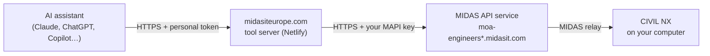

# Security

This page explains how the MIDAS CIVIL NX tools for AI assistants handle your MAPI key, your model and your data, what protects a model from unwanted changes, and how to report a security problem.

The server runs at `midasiteurope.com`. Its source is not published, so everything below describes the live service.

## Reporting a vulnerability

Email **[eusupport@midasit.com](mailto:eusupport@midasit.com)** with "Security" in the subject. Please do not open a public GitHub issue for a security problem.

Say what you found, how to reproduce it, and what an attacker could do with it. We reply within 5 working days, keep you informed until it is fixed, and credit you in the release notes if you would like that. Please give us a reasonable time to fix it before you publish anything.

In scope: `midasiteurope.com/mcp`, `/mcp/c/…`, `/api/v1/…`, the `/llm` token page and the Claude Desktop extension in [`desktop/`](desktop). Out of scope: CIVIL NX itself and the MIDAS API service (report those to MIDAS IT Co., Ltd.), and the AI assistants that call the tools.

## How a call travels

1. Your assistant sends a tool call to `midasiteurope.com`, carrying your **personal token** (`cnx_…`), not your MAPI key.
2. The server looks up the token, decrypts the MAPI key stored with it, and runs the tool.
3. The tool talks to your open model through the MIDAS API service, the same service the plugins use. MIDAS relays each call to the CIVIL NX session that the key belongs to.
4. The result goes back to your assistant.

The MIDAS API has several regional servers (UK, India, US, Korea). To reach the one your CIVIL NX is attached to, the server asks each of them whether your key is connected. Your key is only ever sent to MIDAS's own servers.

**Calculation tools** (wind, thermal, PD 6694, the MIDAS manual search and so on) need no token and never touch a model.

## Your MAPI key and personal tokens

| What | How it is kept |
|---|---|
| Your MAPI key | Checked with MIDAS when you make the token, then stored **encrypted (AES-256-GCM)** with the token. It is decrypted only while a call runs, and is never logged or sent back to you or your assistant. |
| The personal token | Shown to you **once**. The server keeps only its SHA-256 hash, so a copy of the server's data cannot be turned back into a working token. |
| Identifiers for undo records, jobs and limits | A keyed hash (HMAC-SHA-256) of the MAPI key, never the key itself. |

- **Tokens need an account.** Only a signed-in MIDAS IT Europe account can make a token, and every token belongs to one account. A bare MAPI key with no token can run the calculation tools and nothing else.
- **Read-only tokens.** Tick *Read-only* when you make a token: the assistant can then read and preview, but every call that would change the model is refused by the server, whatever the assistant asks for.
- **Revoking.** Revoke a token on [midasiteurope.com/llm](https://midasiteurope.com/llm). It stops working at once, and its encrypted key is deleted. Whoever holds a MAPI key can also revoke every token made with it.
- **Changing the key.** *Change key* on the same page replaces the encrypted key inside a token. The old key is overwritten.
- **Expiry is optional.** A token works until you revoke it, unless you give it an expiry when you make it (30 days, 90 days or a year). An expired token is refused at once and deleted within the hour. Treat a token like a password: anyone who has it can work on whichever model your MAPI key is connected to, until you revoke it or it expires. If one leaks, revoke it and make a new one.
- **The connector URL contains the token.** `https://midasiteurope.com/mcp/c/<token>/lazy` is as private as the token. Request paths can appear in the hosting provider's access logs, which only the site operators can see. If your client supports it, sending the token as `Authorization: Bearer <token>` keeps it out of the URL.
- **Claude Desktop** keeps the token in your system's secure store (the extension marks it as sensitive). **VS Code** asks for it once and stores it securely, so it never sits in `mcp.json`.

## What protects your model

These checks run on the server. They do not rely on the assistant behaving well.

- **Preview first.** Every tool that changes a model previews by default and writes nothing. To write, it has to be called again with `apply: true` and the `planHash` of the preview. If the model or the inputs have changed since the preview, the write is refused.
- **One change at a time.** Only one model-changing job runs per MAPI key, and at most two long jobs in total. The same apply sent twice within 15 minutes is carried out once.
- **Undo.** Every applied change is recorded (the ids created and the rows replaced). `undo_run` lists the recorded changes and reverses one with that plugin's own undo, preview first. The last 200 changes per key are kept.
- **Task profiles.** A connection made to `/mcp/p/<profile>` (or `/mcp/c/<token>/p/<profile>`) lists only that profile's tools, and the server refuses any other tool called by name on it. Use one to keep an assistant to one kind of work, for example `checks` for assessments. Combine it with a read-only token when the assistant should not change the model at all.
- **Destructive options are labelled.** Inputs that delete or replace existing data are marked DESTRUCTIVE, and generic table deletes need an explicit `allowDestructive`.
- **Limits.** 120 tool calls a minute per account, 20 token changes an hour per account and per address, batches of up to 20 messages, request bodies up to 6 MB.

**What the server cannot check:** a `planHash` proves that the write matches a preview, not that a person looked at the preview. An assistant could preview and apply in a row. If your assistant can ask before each tool call, keep that on for these tools, or use a read-only token when you only want answers.

## Prompt injection

Model data reaches your assistant: load case names, group names, section names and so on. So does the text of MIDAS manual articles. Someone who can edit a model you open could put instructions in those names. The tools return all of this as data inside JSON and never act on it. Whether your assistant follows instructions it finds there depends on the assistant. This is one more reason to keep confirmation prompts on for tools that change the model, and to open models from people you do not trust with a read-only token.

## What is stored and for how long

| Data | Kept for |
|---|---|
| A token's encrypted MAPI key, its name, scope, expiry and owner | Until you revoke the token, or within an hour of the expiry you chose |
| The token's last use (to the hour) | As long as the token |
| Undo records (ids created, rows replaced) | The last 200 changes per key |
| Background job records (the tool's inputs and its result) | 7 days; the job's copy of the encrypted key is cleared as soon as the job ends |
| Files a tool made for you (IFC, DXF, XLSX, PDF) | 24 hours, behind a signed link |
| Rate-limit counters | 2 hours |
| Usage counts (tool name, success or failure, country, client name) | Kept for statistics. Never the token, the key, your IP address or the tool's inputs |

The server runs on Netlify (United States), with data in Netlify's storage. Accounts are held by Supabase in the EU. The [privacy notice](https://midasiteurope.com/privacy) has the legal details. What a tool returns is read by your AI assistant under that provider's own terms, so check your assistant's data settings for models you treat as confidential.

## Other measures

- HTTPS only. There is no OAuth sign-in: the token is the only credential, and the OAuth and OpenID discovery addresses answer 404 so clients do not look for one.
- Sign-ins are checked with the site's own Supabase project. No service-role key is used.
- Download links and the background-job trigger are signed with HMAC and checked in constant time.
- A job's status and result are only shown to the token and account that started it.
- The Claude Desktop extension in [`desktop/`](desktop) is a small bridge with no dependencies and no tool code. It forwards calls to `https://midasiteurope.com/mcp/lazy` only, unless you set `MIDAS_MCP_URL` yourself.

## You remain the engineer

Security covers who can reach your model. It does not make the results right. Check every preview, check the model after a change, and verify results before you rely on them. The tools do not replace professional engineering judgement. [`VERIFICATION.md`](VERIFICATION.md) lists which calculations have been checked against published examples and code equations, and which have not.
